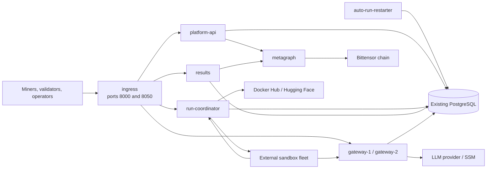

# Container responsibilities

This document describes the Docker deployment in this repository: which
containers exist, which requests and background work each owns, and how they
work together. It describes the current extraction, which preserves the
existing SOMA HTTP API and PostgreSQL schema. It does not introduce an event
bus, per-service database ownership, or independent scoring writers.

Use [the Docker deployment guide](docker-deployment.md) for prerequisites,
configuration, deployment commands, and cutover.

## Topology

`compose.yaml` runs the platform services on one private `backend` network.
Only `ingress` publishes ports to the host. The sandbox fleet is an
external dependency and is not built, run, or configured by this repository's
Compose deployment.

## Services at a glance

| Compose service | Build folder | HTTP ownership | Background ownership | Persistent state |
| --- | --- | --- | --- | --- |
| `ingress` | `mcp_platform_services/ingress` | Public port 8000 and gateway port 8050; routing only | None | None |
| `metagraph` | `mcp_platform_services/metagraph` | Internal metagraph snapshot and economics API | Bittensor synchronization | `metagraph-state` volume |
| `platform-api` | `mcp_platform_services/platform-api` | Miner and validator endpoints | Validator heartbeat | `api-state` volume |
| `run-coordinator` | `mcp_platform_services/run-coordinator` | `/api/private/sandbox/*` callbacks | Competition seeding, dispatch, run recovery, and task publication | `coordinator-state` volume |
| `auto-run-restarter` | `mcp_platform_services/auto-run-restarter` | None | Retry-policy scan and deletion of eligible failed runs | `restarter-state` volume |
| `results` | `mcp_platform_services/results` | `/api/private/frontend/*` and `/api/private/incentives/*` | Aggregate snapshot refresh | `results-state` volume |
| `gateway-1`, `gateway-2` | `mcp_platform_services/gateway` | Existing OpenAI-compatible gateway routes on port 8050 | None | One `gateway-*-state` volume per instance |

All platform services except `metagraph` connect to the existing PostgreSQL
database. This is a shared schema during the current transition; a container's
responsibility does not mean it owns every table it reads or writes.

## Request routing

Ingress preserves the existing public URLs and response contracts. It passes
request bodies through unchanged, which matters for signed miner and validator
payloads. It also disables buffering for gateway streams.

| Incoming URL or port | Destination | Reason |
| --- | --- | --- |
| Miner and validator API routes on port 8000 | `platform-api:8000` | Registration, signed requests, validator state, and validation flow live together. |
| `/api/private/sandbox/*` on port 8000 | `run-coordinator:8000` | Sandbox callbacks change run state and are consumed by the dispatch workflow. |
| `/api/private/frontend/*` on port 8000 | `results:8000` | Frontend-facing aggregate reads have their own refresh loop. |
| `/api/private/incentives/*` on port 8000 | `results:8000` | Incentive views use the same economics data path as frontend reads. |
| `/docs`, `/redoc`, `/openapi.json` | `platform-api:8000` | The API container serves the combined legacy schema for clients and operators. |
| Any existing gateway endpoint on port 8050 | `gateway-1:8050` or `gateway-2:8050` | Ingress balances the LLM proxy pool while preserving the port and URL. |

Backends are not host-published. `ingress` is assigned the fixed private address
`172.30.114.10`; the application containers trust only that address for
forwarded/private-route checks. It replaces client-supplied forwarding headers
instead of trusting them.

## `platform-api`

`platform-api` is the synchronous API owner for miners and validators. It is
the normal entry point for wallet-signed platform traffic. Its service role is
`api`, which loads only the miner and validator routers.

It uses a cached internal client for the metagraph snapshot, while the dedicated
`metagraph` container owns the Bittensor connection. It also keeps the
registered-validator state needed by those API paths in memory. Its wallet directory
is mounted read-only at `/run/wallets`; this container should be given the only
normal platform access to private wallet material. The process runs as UID 10001,
so its selected hotkey must grant that UID read access while retaining private
permissions (for example, owner UID 10001 and mode `0600`).

The container stores service-local logs, caches, and other runtime files in the
`api-state` Docker volume. PostgreSQL remains the source of truth for platform
data. The container has no Docker socket and does not dispatch sandbox work.

## `run-coordinator`

`run-coordinator` owns work progression. Its service role is `coordinator`, so
it serves sandbox callback endpoints and starts the SWE-bench orchestrator. The
orchestrator finds eligible competition work, creates and dispatches runs to the
configured sandbox fleet, and recovers its work after restart using the existing
database state and advisory locking.

It also retains Docker Hub and Hugging Face task publication. Publication stays
beside dispatch because the current task-readiness snapshots are process-local
and dispatch relies on them. Separating publication before making those snapshots
durable would risk dispatching work that is not ready or blocking valid work.

The coordinator never runs retry work itself. Task source files are mounted
read-only at `/data/tasks`.

## `auto-run-restarter`

`auto-run-restarter` independently scans the shared database for failed runs
that match the established retry policy, deletes those rows, and records audit
metadata. The coordinator seeds replacement work on its ordinary tick. The
worker has no public endpoint and does not call the sandbox fleet.

Its `restarter-state` volume contains restart counters, JSONL audit records,
and a health marker written only after a successful database scan. PostgreSQL's
advisory lock remains a protection against accidental duplicate workers, while
Compose explicitly disables the former coordinator-embedded loop.

The worker starts only after coordinator readiness. Its no-port Docker health
check considers it healthy after a successful scan and unhealthy when its marker
is stale. It must remain a single service: the advisory lock is a safety net,
not a horizontal-scaling mechanism. See the
[service README](../../mcp_platform_services/auto-run-restarter/README.md) for controls,
audit files, dry-run operation, and recovery commands.

The coordinator sends execution requests to the existing remote sandbox fleet.
It does not receive the host Docker socket and does not execute benchmark
containers itself. Building and operating the sandbox executor, its harnesses,
and validation environment are outside this Docker deployment.

## `results`

`results` owns read-oriented frontend and incentive endpoints. Its service role
is `results`, which loads the frontend and incentive-admin routers. It runs the
aggregate refresh task. Displayed economics depend on chain data supplied by the
dedicated metagraph service.

The service persists aggregate snapshots and local cache files in `results-state`.
It gets current chain economics from the same cached metagraph client used by the
API. It does not seed, dispatch, publish, or receive sandbox callbacks. This keeps
frontend-refresh failures from stopping run dispatch and keeps run activity from
restarting the frontend cache process.

## `metagraph`

`metagraph` owns the only Bittensor chain connection in the Compose platform
stack. It synchronizes the configured subnet and keeps the current snapshot in
memory. Its internal endpoints provide that snapshot and registration-cost/alpha-
price reads to `platform-api` and `results`.

The service does not connect to PostgreSQL, has no wallet mount, and is not
published through ingress. API and results containers poll it into a small local
cache so their existing request handlers can keep synchronous snapshot access.
Those containers wait for the metagraph health check before starting. Restarting
`metagraph` therefore refreshes the chain process independently; consumers become
temporarily unready when their cached connection cannot be refreshed and recover
when a new snapshot is available.

## Gateway pool

`gateway-1` and `gateway-2` are identical, independently restartable instances
of the existing OpenAI-compatible LLM proxy, exposed through ingress on port
8050. They resolve the run's model-key policy from PostgreSQL, read the selected
secret from SSM, and stream requests to the configured upstream provider. Their
public behavior and URL shape are preserved for benchmark callers.

Failed-call records are written beneath `/var/lib/soma/failed_calls` in an
instance-specific state volume. Ingress uses least-connections balancing and
re-resolves Docker service addresses after a replacement. The update script in
`mcp_platform_services/gateway/rolling-update.sh` drains one instance at a time, waits for
existing streams, recreates it, then proceeds to the other instance. A drain
rejects traffic before a model request begins, allowing ingress to retry only
that known-safe case on the peer. The gateway uses the database and AWS identity
it needs for key selection and SSM access, but it has no wallet mount and no
Docker socket.

For planned maintenance, run `./mcp_platform_services/gateway/rolling-update.sh` to replace
the full pool one instance at a time. To remove one member without replacing it,
run `./mcp_platform_services/gateway/rolling-update.sh --graceful-stop gateway-1`. That mode
drains the selected instance, waits for the active-request count to reach zero,
and then stops it; it accepts exactly one member so the peer remains available.
Do not use `docker compose stop` directly for a gateway that may still have
provider streams.

## `ingress`

`ingress` is an Nginx reverse proxy. It is the only container in the normal
platform stack that binds host ports: 8000 for the platform API and 8050 for the
gateway. It has no database credentials, wallet mount, or persistent data.

It waits for all normal backends to be healthy before starting. Its liveness
endpoint, `/health/live`, only verifies Nginx itself. Application readiness is
checked at each backend's `/health/ready` endpoint and includes database
connectivity.

## Startup, health, and restart behavior

Each Python service runs one Uvicorn worker. A worker is intentional for now:
several existing parts of the platform keep short-lived state in process memory,
including nonce caches, registered validator data, publication readiness,
aggregate caches, and retry budgets. Do not horizontally scale a service until
the relevant state and locking are made shared.

All normal services use `restart: unless-stopped` and Docker health checks.
Readiness means the service has completed startup, its required background tasks
are still running, and the database is reachable where applicable. Metagraph
readiness additionally requires a connected chain client and a synchronized
snapshot. Docker restarts a process that exits; it does not automatically restart
a process that remains alive but becomes unhealthy, so production monitoring
should alert or remediate that state.

The compose deployment runs application processes as UID 10001 and drops Linux
capabilities. State volumes are intentionally separate so service-local cache or
retry data does not collide.

## Build ownership

Every container has a dedicated build folder under [mcp_platform_services/](../../mcp_platform_services):
its `Dockerfile` and short service README live there. Builds use the repository
root as their Docker build context, allowing the platform images to copy the
shared application code while keeping the build definition close to the service
that owns it.

The Python source follows the same boundary. `mcp_platform_services/common/app` holds shared
configuration, persistence, contracts, blob storage, and the application factory.
Each HTTP platform service owns its routers and operational code in its own
`app/` folder. These packages compose into the existing `app.*` namespace, so
external route paths and established internal imports remain compatible. There
is no combined-process compatibility shim: each container imports only its owned
service package plus `mcp_platform_services/common`.

Several competition classification helpers are still called directly by API and
results code. Their coordinator-owned implementation is included only in those
affected images until an internal versioned API replaces the in-process calls.
The API image also carries the results route package solely to publish the
combined legacy OpenAPI schema. These compatibility imports do not start
coordinator or results routes and workers in the API process.

The platform image builds consume a compatible `SOMA-shared` checkout as a named
BuildKit context. Docker image layers are stored by Docker, so a repository
`build/` directory is intentionally not created.

## Current boundaries and future work

The split separates process lifecycles and route ownership while retaining API
compatibility. It does not yet make the services independently scalable or give
them separate database schemas. In particular:

- The coordinator owns publication because readiness data is not yet durable.
- The metagraph snapshot is centralized, but it is still memory-backed. A future
  durable snapshot store would allow API and results to serve a known last-good
  snapshot during a metagraph restart.
- Benchmark execution and validation infrastructure remain external to this
  deployment; the coordinator only calls the configured remote sandbox API.
- All services use the same PostgreSQL schema and must be deployed with
  coordinated migrations.
- The current route split preserves a combined OpenAPI document at the legacy
  URL; clients should not need to discover the internal container layout.

The proposed longer-term outbox, durable task state, and explicit data ownership
are documented in [microservices-architecture.md](microservices-architecture.md).
