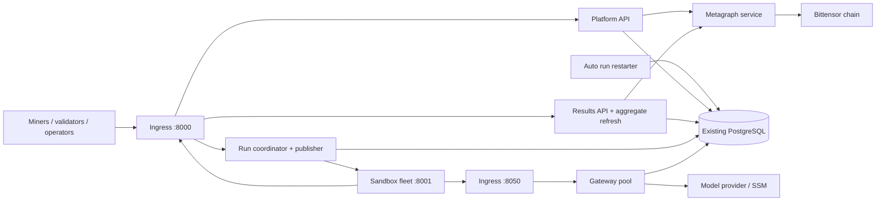

# Docker service deployment

The repository now contains a Compose deployment for the local platform services.
It preserves existing HTTP paths, signed payloads, response models and shared
database tables. This is the first extraction step toward the
[microservices proposal](microservices-architecture.md), not an event-bus or
database-ownership migration.

For a container-by-container explanation of ownership and interactions, see
[Container responsibilities](container-responsibilities.md).

## Running architecture



| Container | Build folder | Responsibilities |
| --- | --- | --- |
| `metagraph` | `mcp_platform_services/metagraph` | Bittensor connection, subnet snapshots and economics reads |
| `platform-api` | `mcp_platform_services/platform-api` | Signed miner and validator APIs, registration state, validator heartbeat |
| `run-coordinator` | `mcp_platform_services/run-coordinator` | Run seeding, dispatch, recovery, sandbox callbacks, and Docker/HF publication |
| `auto-run-restarter` | `mcp_platform_services/auto-run-restarter` | Independent retry-policy worker; deletes eligible failed runs for coordinator reseeding |
| `results` | `mcp_platform_services/results` | Frontend and incentive APIs, aggregate refresh |
| `gateway-1`, `gateway-2` | `mcp_platform_services/gateway` | Two streaming LLM proxy instances, run-based key resolution and provider policy |
| `ingress` | `mcp_platform_services/ingress` | Route original API URLs and gateway port to their owning services |

Publication remains with the coordinator because image and dataset readiness are
currently process-local snapshots used by dispatch gates. Separating these into
unconnected workers would block dispatch or weaken those gates. SC1/SC2 decisions
also retain their current implementation; no second independent scoring writer
is introduced. The remote sandbox and benchmark-validation infrastructure are
outside this deployment; the coordinator communicates with them through the
existing callback and dispatch contract.

Each HTTP application runs one Uvicorn worker. Do not scale these services yet:
nonce caches, registered-validator state, aggregate caches and publication
snapshots still have process-local components. `auto-run-restarter` is a separate
single worker and uses a PostgreSQL advisory lock. No platform service needs the
host Docker socket.

`metagraph` is deliberately a separate process. API and results obtain its snapshot
through an internal cached client (`METAGRAPH_SERVICE_URL`); they no longer create
their own Bittensor connections. Restarting that service restarts only chain sync.
Its health check waits for a synchronized snapshot, and API/results wait for that
health check before starting.

The exception is the gateway: `gateway-1` and `gateway-2` are intentionally a
small, independently addressable pool. They do not hold platform correctness
state; their failed-call files are persisted below
`$SOMA_RUNTIME_DIR/gateways/failed_calls/<gateway-instance>/`. The shared parent
is safe because every replica has a distinct `GATEWAY_INSTANCE_ID` and therefore
never appends to another replica's daily audit JSONL. Ingress uses least
connections and Docker DNS re-resolution so a recreated gateway gets a new IP
without an ingress restart. The public URL remains port 8050.

## Build inputs and configuration

Use Linux, Docker Engine, BuildKit and Docker Compose 2.20+ (additional build
contexts and Compose include support). Build from the repository root.

The build consumes the **compatible SOMA-shared checkout** selected by
`SOMA_SHARED_CONTEXT` as an additional context. Only package sources and packaging
metadata are copied, not its `.env`, wallets, `.git` directory or database dumps.
The platform keeps its validation-log redaction helper in this repository, so the
container build does not depend on a newer shared utility module. The run-log API
compatibility contracts also live in this repository, so the configured
`../SOMA-shared` checkout for this branch builds without switching its branch.
SOMA-shared remains required for the shared database, signature, and envelope
contracts. Use a separate checkout if the shared branch paired with this platform
branch is elsewhere:

```bash
git clone https://github.com/DendriteHQ/SOMA-shared.git ../SOMA-shared-docker
cp .env.example .env
# In .env, set SOMA_SHARED_CONTEXT=../SOMA-shared-docker.
```

Pin that checkout to a reviewed commit for repeatable releases. The application
images intentionally exclude benchmark/grading dependencies because sandbox and
validation infrastructure are deployed separately. `mcp_platform_services/common/requirements.txt`
is the shared application dependency set; it pins the Bittensor 10.3 runtime used
by the platform containers. The older monolithic requirements files are not used
for these images. Local dependency installation does not need to be changed.

Application source is owned under `mcp_platform_services/<service>/app`; `common/app`
provides shared infrastructure and the lifecycle composition root. The Dockerfiles
place those folders on the Python namespace path, retaining established `app.*`
imports and current API behavior. Coordinator competition-classification helpers
are currently called by API and results paths, so that package is included in
those images as a compatibility dependency without enabling coordinator workers.
The API image also includes results route definitions solely to generate the
combined legacy OpenAPI schema; it does not start results workers.

Populate `.env` using the existing deployment's configuration, including:

- `POSTGRES_DSN`, or `RDS_SECRET_ID` with the existing RDS settings. Use a writer
  endpoint for writes; the optional reader settings remain supported.
- AWS region and credentials or container-compatible instance/task identity, S3
  bucket and SSM key prefix. AWS CLI is available for existing secret lookup code.
- Wallet name and hotkey. Set `SOMA_WALLETS_DIR` to the directory containing named
  wallets; it is mounted read-only at `/run/wallets` in the API container.
- Remote sandbox URLs, model settings, provider settings and baseline API key.
- Bittensor network settings and the internal `METAGRAPH_SERVICE_URL` (the Compose
  default is `http://metagraph:8000`).
- Existing task publication credentials and feature flags. The example disables
  publication until configured; do not use those disabled values accidentally
  when replacing a deployment that publishes tasks.

All service-local runtime data is bind-mounted from `SOMA_RUNTIME_DIR`, including
rotated logs, caches, aggregate snapshots, dispatch/restart audit records, and
gateway failed-call records. Its default is `../SOMA/runtime`, which resolves to
`/root/SOMA/runtime` for this checkout. Set an absolute value when the sibling
layout is not used. Before the first start, prepare the directories for the
unprivileged container user:

```bash
sudo ./mcp_platform_services/prepare-runtime-state.sh
```

The script dynamically locates this checkout to choose its default and creates
one UID/GID `10001` owned directory per service. It does not create or modify
wallets or task-definition inputs. Treat the runtime directory as operational
data and back it up with a retention policy appropriate for logs and audits.

Translate host filesystem paths to their container mounts. For example, task rows
under `SOMA_TASKS_DIR` are visible to the coordinator at `/data/tasks`; set
`HF_DATASET_SOURCE_FILE=/data/tasks/soma_tasks_grading.jsonl` rather than keeping a
host-only `/root/...` path. Remote callback and model-provider URLs must remain
reachable from the network of their actual caller.

Application containers run as UID 10001. Give that UID access to the mounted wallet
without making private keys world-readable. For a private hotkey file with mode
`0600`, changing its owner to UID 10001 while retaining mode `0600` is suitable;
the wallet mount remains read-only in the container. Results, API, coordinator and
gateway state use distinct persistent volumes owned by that UID. When using an AWS
profile instead of environment credentials, provide an explicit read-only credential
mount and set its standard AWS path variables. Host AWS profile files are not copied
or mounted automatically. EC2 instance metadata access from bridged containers can
require an appropriate instance metadata hop limit.

Compose reads `.env` for interpolation and runtime settings. To use another file:

```bash
SOMA_ENV_FILE=/absolute/path/soma.env docker compose --env-file /absolute/path/soma.env config --quiet
```

The example `host.docker.internal` database address uses an explicit host-gateway
mapping on Linux. A database listening only on host loopback will still need a
reachable listener. External PostgreSQL/RDS, S3, SSM, chain endpoints and sandbox
hosts are existing dependencies; normal Compose startup does not create them.

## Database lifecycle

The legacy single-process role has been removed. Every service forces
`DB_INITIALIZE_SCHEMA=false` and rejects debug database clearing or mock seeding.
Startup verifies connectivity without creating tables, changing ownership, or
dropping/replacing views. Run Alembic migrations from the compatible SOMA-shared
release as a separate operator task before deploying.

SOMA-shared currently bundles connection setup and DDL in `init_db`. A small adapter
in `app/runtime/database.py` initializes its existing session registry without DDL.
Keep that adapter covered by compatibility checks when upgrading SOMA-shared; it
can be removed once shared exposes a connection-only initializer.

## Build, check and start

```bash
docker compose config --quiet
docker compose build
docker compose up -d
docker compose ps
docker compose logs --tail=100 platform-api run-coordinator auto-run-restarter results gateway-1 gateway-2
```

All containers have health checks. Ingress starts after its backends are healthy.
Python readiness checks include the database; platform roles also detect stopped
background tasks. Health checks report failures but do not automatically restart
an unhealthy, still-running process. Configure monitoring or an orchestrator for
that behavior; the restart policy handles exited processes.

All deployment and build inputs live at the repository root and under `mcp_platform_services/`.
There is no legacy monolithic Dockerfile or Compose entry point.

## API compatibility and ingress trust

| Existing path | Destination |
| --- | --- |
| Miner and validator routes | `platform-api:8000` |
| `/api/private/sandbox/*` | `run-coordinator:8000` |
| `/api/private/frontend/*` | `results:8000` |
| `/api/private/incentives/*` | `results:8000` |
| `/docs`, `/redoc`, `/openapi.json` | API, with the combined original schema |
| Existing gateway paths on port 8050 | `gateway-1:8050` or `gateway-2:8050`, selected by ingress |

Ingress forwards request bodies without translating signed payloads. Gateway
response buffering is disabled for streaming. Its request bodies are buffered
only so a gateway that has explicitly drained can be retried once on its peer
before the request reaches a model provider. Backend DNS is resolved periodically
so replacing a container does not require restarting ingress.

## Gateway updates without interrupting streams

Use the supplied update command whenever gateway code, dependencies, or its
runtime image changes:

```bash
./mcp_platform_services/gateway/rolling-update.sh
```

It builds the image, asks `gateway-1` to drain, waits until its in-flight request
count reaches zero, recreates it and waits for readiness. It then does the same
for `gateway-2`. A drained instance rejects new `/v1` traffic before reading the
request or calling a provider. Ingress recognizes that reserved internal response
and replays the already buffered request only to the other gateway. It does not
retry 429 or 5xx provider responses, which could duplicate a charged call.

The script accepts an explicit instance for a targeted update:

```bash
./mcp_platform_services/gateway/rolling-update.sh gateway-2
```

To remove a single gateway from service without replacing it immediately, use
the same drain path rather than `docker compose stop` directly:

```bash
./mcp_platform_services/gateway/rolling-update.sh --graceful-stop gateway-1
```

This marks `gateway-1` draining, waits for its active work to reach zero, then
stops it. Keep `gateway-2` running; the command deliberately accepts exactly
one instance so it cannot take the full pool offline. Start or replace the
stopped member later with the normal rolling-update command.

`GATEWAY_DRAIN_TIMEOUT_SECONDS` defaults to 1800 seconds and is a safety bound:
on expiry the script exits without replacing that instance, leaving it drained
while the peer continues serving traffic. Investigate the active stream before
rerunning the command. `GATEWAY_STOP_GRACE_PERIOD` defaults to 30 minutes so an
operator-initiated stop also has enough time for normal model streams. Gateway
control endpoints accept only loopback requests inside the gateway container and
are blocked at ingress; use the script instead of publishing them.

Ingress overwrites client-supplied `X-Forwarded-For` with the source it observes.
Backend Uvicorn proxy-header rewriting is disabled so application private-network
checks can validate the actual ingress peer. Only ingress's static
`172.30.114.10/32` address is trusted by those checks. Backend ports are not published.
Set `PRIVATE_NETWORK_CIDRS` for the operators/sandbox networks that may use private
routes. Frontend API-key checks and signed endpoint verification are retained.

The bridge subnet is `172.30.114.0/24`; change the subnet, ingress address and trusted
proxy CIDR together if it conflicts with your infrastructure. If another reverse
proxy or load balancer precedes this ingress, configure trusted real-IP handling
for that proxy explicitly. Do not forward arbitrary client IP headers unchanged.
TLS termination remains at the existing external proxy/load balancer.

## Retry service and persistent state

`auto-run-restarter` is a separate worker with durable state in
`$SOMA_RUNTIME_DIR/auto-run-restarter`.
It starts after the coordinator is healthy, scans retryable terminal runs, and
deletes eligible rows so coordinator seeding creates replacements. Existing
`AUTO_RUN_RESTARTER_*` controls, including dry-run mode, still apply. A health
marker is updated only after a successful database scan.

Compose forces `COORDINATOR_RESTARTER_ENABLED=false`, so the coordinator cannot
start a duplicate loop. PostgreSQL's advisory lock remains a final safeguard if
an operator accidentally starts another restarter. The split preserves existing
deletion/reseeding semantics; it does not introduce durable attempt versioning
or transactional retry-count storage.

Its state directory contains `restart_counts.json`, `last_successful_tick`, and
daily `YYYY-MM-DD/restarted_runs.jsonl` audit files. The health check accepts a
marker no older than `max(180 seconds, 3 × configured interval + 30 seconds)`.
Use the worker's [service README](../../mcp_platform_services/auto-run-restarter/README.md)
for the complete configuration table, dry-run procedure, logs, and targeted
rebuild/restart commands.

## Cutover and rollback

1. Build and verify images without touching the current PM2 services. Use different
   ports and a separate database for staging; never run two coordinators against
   live competitions just for a smoke test.
2. Apply shared migrations and configure wallet/AWS/task inputs. Preserve publication
   policy and provider/model settings from the existing deployment.
3. Stop the old platform coordinator and standalone restarter before starting this
   stack against the same database. Drain in-flight requests, preserve callback URLs
   and account for cached frontend state.
4. Release or reroute ports 8000/8050, then start Compose. Confirm upload/validator
   requests, sandbox callbacks, streaming and task readiness.
5. On rollback, stop the Docker coordinator before restoring the prior process.
   Restore routing rather than deleting database history or host runtime data.

This change does not manage the separately maintained SOMA-admin-endpoints project,
move schema ownership, or deploy the proposal's outbox/event transport. Those are
separate migrations. Do not run `docker compose down -v` as a routine restart.

## Verification

To repeat the isolated Docker smoke checks after building the platform stack:

```bash
docker tag soma-platform-api:latest soma-containered-api:verify
docker tag soma-gateway-1:latest soma-containered-gateway:verify
docker tag soma-ingress:latest soma-containered-ingress:verify
python3 mcp_platform_services/tests/verify_docker.py
```

This uses disposable containers, an independent PostgreSQL database and random
loopback ports. It never reads the deployment `.env`, uses real wallet credentials,
or dispatches competition runs. It creates its temporary test schema directly,
then verifies the non-DDL connection adapter with a SELECT-only account,
coordinator readiness, ingress routing/body preservation, spoofed forwarding
headers, and SSE forwarding through the real gateway. Containers and the test
network are cleaned up afterward.

Run the build and isolated smoke checks before each rollout. Live AWS/chain
credentials, real signed client traffic and remote-sandbox integration still require
deployment-specific acceptance checks before production cutover.
