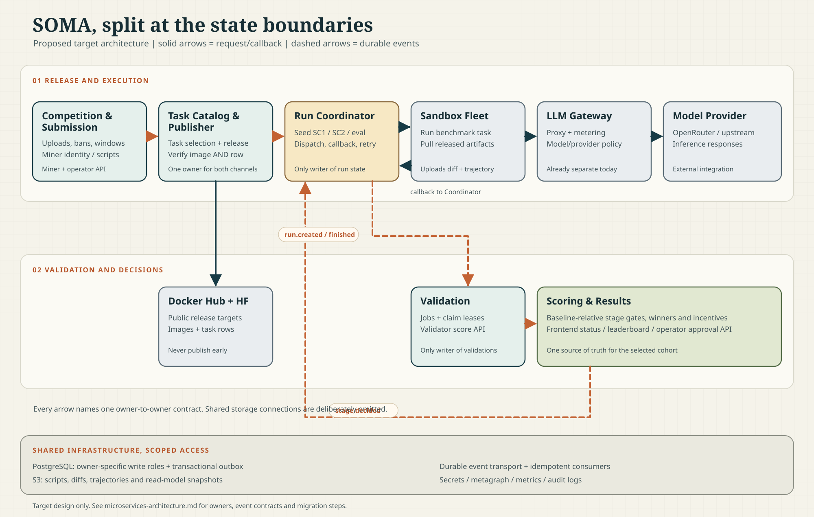

# SOMA microservices: proposed target architecture

This is a **design proposal**, not a description of a deployed migration. The
current platform is a group of FastAPI services that hosts API routes and starts
background loops from [`bootstrap.py`](../../mcp_platform_services/common/app/bootstrap.py). The LLM
[`gateway`](../../mcp_platform_services/gateway/gateway/main.py), remote sandbox fleet, and
[`auto_run_restarter`](../../mcp_platform_services/auto-run-restarter/auto_run_restarter/service.py) are already separate
processes, but they still depend on the same database and lifecycle rules.

## Design principles

- Split by **state ownership and failure mode**, not by individual Python files.
- Give exactly one service write authority for each business entity. A shared
  PostgreSQL cluster is acceptable during migration; unrestricted cross-service
  table writes are not.
- Keep run seeding, dispatch, callback handling, and stale-run recovery in the
  **Run Coordinator**. The separate Auto Run Restarter may delete only eligible
  failed rows under an advisory lock; the coordinator remains the process that
  seeds and dispatches replacements.
- Keep Docker image and Hugging Face task-row publication in **one Task Catalog
  and Publisher**. A task is ready only when both required artifacts are
  reachable from the relevant sandbox and validator environments.
- Move stage qualification into **Scoring and Results**, but make advancement an
  immutable, versioned decision. The Run Coordinator consumes that decision; it
  must not independently recalculate the cohort.
- Preserve the existing signed miner/validator contracts and public URLs behind
  routing. Move implementations without requiring simultaneous client upgrades.

## Service ownership

| Boundary | Owns | Responsibilities | Existing code to extract |
| --- | --- | --- | --- |
| Competition and Submission | Competitions, timeframes, miners, bans, scripts, uploads, miner API-key references | Verify signed uploads and upload windows; store scripts in S3; publish upload/ban/timeframe changes; maintain metagraph identity snapshots; provide controlled gateway key lookup | [`miner.py`](../../mcp_platform_services/platform-api/app/api/routes/miner.py), [`script_store.py`](../../mcp_platform_services/platform-api/app/services/script_store.py), [`metagraph_runner.py`](../../mcp_platform_services/metagraph/app/services/metagraph_runner.py) |
| Task Catalog and Publisher | Task definitions, competition-task assignments, artifact release state | Import tasks; mirror private images to public Docker Hub and rows to Hugging Face at the allowed window; verify both channels; publish durable task readiness; never reveal a future competition's hidden tasks | [`dockerhub_visibility.py`](../../mcp_platform_services/run-coordinator/app/services/dockerhub_visibility.py), [`dockerhub_task_sync.py`](../../mcp_platform_services/run-coordinator/app/services/dockerhub_task_sync.py), [`hf_task_sync.py`](../../mcp_platform_services/run-coordinator/app/services/hf_task_sync.py) |
| Run Coordinator | Runs, attempts, leases, dispatch and restart decisions | Seed baseline/SC1/SC2/eval matrices; enforce phase, ban, capacity and readiness gates; call sandbox fleet; accept idempotent callbacks; persist patch/trajectory references | [`swebench_orchestrator.py`](../../mcp_platform_services/run-coordinator/app/services/swebench_orchestrator.py), [`sandbox.py`](../../mcp_platform_services/run-coordinator/app/api/routes/sandbox.py), [`remote_compact_bench_manager.py`](../../mcp_platform_services/run-coordinator/app/services/sandbox/remote_compact_bench_manager.py) |
| Auto Run Restarter | Retryable terminal runs and restart audit metadata | Scan failures under the existing retry policy, enforce caps, delete eligible rows, and use an advisory lock to prevent duplicate workers | [`auto_run_restarter`](../../mcp_platform_services/auto-run-restarter/auto_run_restarter/service.py) |
| Validation | Validation jobs, leases, validator registrations, submitted and verified scores | Create one validation job per run; expose claim/submit APIs with stake and signature checks; auto-score failed or missing-diff runs according to policy; emit a scored event exactly once | [`validator.py`](../../mcp_platform_services/platform-api/app/api/routes/validator.py), existing validation/verified-validation tables |
| Scoring and Results | Stage decisions, aggregate projections, incentive candidates and approvals | Compute baseline-relative SC1 quality, SC2 cohort ranking, final scores and winners; publish frozen advancement decisions; serve frontend status/leaderboard snapshots; expose private approval API | [`swebench_screening.py`](../../mcp_platform_services/run-coordinator/app/services/swebench_screening.py), [`incentive_calculator.py`](../../mcp_platform_services/results/app/services/incentive_calculator.py), [`frontend.py`](../../mcp_platform_services/results/app/api/routes/frontend.py), [`incentive_admin.py`](../../mcp_platform_services/results/app/api/routes/incentive_admin.py) |
| LLM Gateway (existing) | Proxy policy, metering and routing records | Route sandbox model calls to providers; enforce budgets and model/provider policy; resolve miner key references through a narrow identity contract rather than direct business-table reads | [`gateway/main.py`](../../mcp_platform_services/gateway/gateway/main.py) |
| Sandbox Fleet (existing) | Ephemeral execution state | Pull released task images/rows, run benchmark containers and compression code, upload artifacts, report results to Run Coordinator; never decide qualification | [`sandbox_service`](../../sandbox_service) and benchmark integration |

An ingress router routes miner, validator, sandbox-callback, frontend and
operator endpoints to their owning services. It is not another owner of
competition state. S3, PostgreSQL, Docker Hub, Hugging Face, the model provider,
and a durable event transport are **infrastructure/integrations**, not SOMA
business microservices. Avoid a separate generic dispatcher, recovery, or
artifact microservice until a concrete scaling or ownership need justifies one.

## Request and event flows

1. A miner signs an upload. Competition and Submission validates the window,
   ban and signature, stores the script, and emits `submission.accepted`.
2. Task Catalog and Publisher releases the selected task rows and images only
   when the competition window permits. It records a per-task artifact version
   and emits `task.ready` **after** both Docker Hub and Hugging Face are
   externally reachable. A task without both stays blocked.
3. Run Coordinator consumes uploads, task readiness and stage decisions. It
   seeds a run with a stable `(competition, script/baseline, task, benchmark,
   attempt)` key. It also asks Validation to create an idempotent placeholder
   job, matching today's run-plus-validation creation in
   [`_create_run_and_validation()`](../../mcp_platform_services/run-coordinator/app/services/swebench_orchestrator.py).
4. Coordinator dispatches eligible runs to sandbox hosts. Sandboxes pull the
   released artifacts, call the existing Gateway for model traffic, upload
   diffs/trajectories to S3, and callback to Coordinator. The callback is
   authenticated, keyed by run and attempt, and cannot overwrite a newer
   attempt. Coordinator emits `run.finished` after persisting terminal state.
5. Validation exposes the signed claim/submit contract to validators. A run's
   validation job becomes claimable only when its terminal state and artifacts
   are available. It emits `validation.scored` after durable score persistence.
6. Scoring and Results consumes scored validations, waits for the **complete
   expected baseline and miner cohort**, and freezes a versioned `stage.decided`
   result. Coordinator seeds the next stage only from that decision. Scoring
   projects frontend statuses and incentive results from the same decisions.

The current code seeds validation rows with runs, uses an advisory lock around
the orchestration tick, gates dispatch on Docker/HF visibility snapshots, and
recalculates stage passers while seeding. These are precisely the boundaries
that must be changed together, not moved as independent workers.

## Contracts and consistency

Use a transactional outbox in each writer's PostgreSQL transaction, delivered
to a durable queue/topic. This is a **new requirement**; the repository does
not currently implement a common event bus. The specific transport can be
chosen after throughput and operational requirements are measured. Every
consumer records processed event IDs and is idempotent. Events carry
`event_id`, `schema_version`, `competition_id`, `occurred_at`, and the entity
ID/version; no script bodies, API keys or presigned URLs travel in events.

| Event/command | Producer -> consumer | Required key and guard |
| --- | --- | --- |
| `submission.accepted`, `miner.banned` | Competition -> Coordinator, Results | Upload/script ID; ban version; invalidate only not-yet-dispatched work per policy |
| `task.ready`, `task.revoked` | Catalog -> Coordinator, Validation | Competition/task/artifact version; dispatch requires both image and row ready |
| `run.created`, `run.finished` | Coordinator -> Validation, Results | Run ID + attempt; create one job; ignore duplicate/older terminal reports |
| `validation.scored` | Validation -> Results | Validation ID + score version; deduplicate rescoring and revalidation |
| `stage.decided` | Results -> Coordinator, public projection | Competition + stage + decision version + full selected script IDs + cohort watermark |
| `run.retry.requested` | Operator/automated policy -> Coordinator | Run ID + reason + idempotency key; coordinator alone changes attempt state |

Use one physical PostgreSQL cluster initially, but separate schemas or at least
write roles and migrations by owner. Other services receive events or use
versioned read APIs; temporary read-only compatibility views must have removal
dates. S3 remains an object store with service-scoped prefixes and least-
privilege permissions. The Coordinator owns diff/trajectory references;
Submission owns script references; Validation may read artifacts through
short-lived scoped URLs. Frontend aggregates should be projections, not live
joins across every service database.

Do not let a missed message silently advance a competition. Reconcile event
consumers against owner state; a stage decision needs an explicit expected-run
count, validation completion watermark, and cutoff. Keep retries and restart
counts in the database, not a worker-local JSON file. Prefer superseding a
failed run with a new attempt over deleting its history; retain audit links and
make validator rows reference the exact attempt. A ban after qualification
must invalidate the selection version before any replacement miner is seeded.

## Migration sequence

1. **Stabilize contracts.** Inventory current endpoints/tables, add run and
   validation invariants, trace IDs, and contract tests for SC1 -> SC2 -> eval,
   hidden-task release, bans, duplicate callbacks, and retries. Keep the
   current deployment authoritative.
2. **Extract release management.** Move Docker/HF reconciliation to Task
   Catalog and Publisher. Replace process-local readiness snapshots with a
   durable readiness record; keep current dispatch gate until parity is proven.
3. **Extract run ownership.** Move the orchestrator loop and sandbox callback
   route into Run Coordinator behind the existing endpoint paths. Run the
   auto-restarter as one dedicated worker with its existing advisory lock and
   audit volume. Begin with the same single-leader behavior, then introduce
   leased work if needed.
4. **Extract validation.** Have Validation create jobs from `run.created`,
   shadow-read old rows, then route claim/submit traffic to it. Remove
   Coordinator writes to validation tables only after reconciliation shows no
   missing or duplicate jobs.
5. **Extract scoring/read models.** Compare stage decisions and aggregates in
   shadow mode against today's orchestrator/frontend calculations. Switch
   qualification decisions atomically per competition; never mix decision
   sources within one competition. Route frontend/admin APIs after parity.
6. **Extract Competition/Submission last.** Its identity, upload, ban and key
   contracts touch several clients; maintain signed payload compatibility and
   then remove Gateway's direct business-table lookups.

Each cutover needs a feature flag, lag/error dashboards, an owner-specific
rollback path, and replayable outbox events. Roll back routing and event
consumption, not database history. A service split should be postponed if it
would leave two processes able to modify the same run, validation, or stage
decision row.

## Operational checks

- Queue age, outbox backlog, duplicate-event rate, and reconciliation drift.
- Task artifact readiness for **both** Docker Hub and Hugging Face before
  dispatch; alert on cross-channel mismatch and accidental early publication.
- Run counts by stage/status/competition, oldest pending and dispatched age,
  sandbox capacity, callbacks by attempt, restart counts and reasons.
- Validation claims, lease expiry, time-to-score, missing artifact rate, and
  expected-versus-scored cohort counts.
- Stage decision version, selected cohort size, frontend projection lag and
  incentive recomputation audit trail.
- Gateway provider errors/latency and sandbox disk/container health. Redact
  API keys, miner scripts and presigned URLs from logs and events.
